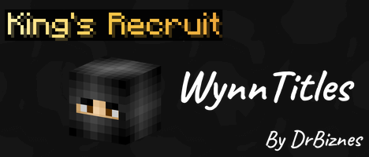

# WynnTitles



Let your nametag do the bragging. WynnTitles is a Minecraft mod that lets you earn title words from Wynncraft achievements and wear them above your name, then style them in a shop with colors, animations and Wynncraft fonts. Everyone else with the mod sees it. No account to make, you log in with the Minecraft account you're already playing on. Made for my modpack [World of Wynncraft](https://modrinth.com/modpack/world-of-wynncraft)

<!-- DROP HERE: marketing/titles/title-reel.gif (best opener, 640x360) -->

## What's Up

- Earn title words from **159 achievements**: quests, raids, dungeons, class levels, professions, exploration, collection, stats, gamemodes, guilds and some secret ones
- Wear a **prefix and a suffix** above your name, and other WynnTitles players see it on your nametag
- Spend your achievement points in the **style shop**: solid colors, palettes, rainbow, bold, italic, underline, strikethrough, **12 animations** and **10 Wynncraft fonts** (text fonts, scripts like Wynnic, and banners)
- Try everything on your title before you buy it
- The big achievements come with their own **native style** that you can't buy, only earn
- Quest and dungeon completions unlock as soon as you finish them, the rest is read from Wynntils
- Every achievement has an icon of the Wynncraft item it's about in a bronze, silver or gold frame
- Shows how rare each achievement is, from Normal all the way down to Mythic
- Screens built to look like Wynncraft's own menus, with an unlock pop-up and chat message when you earn something
- Doesn't need a website, everything happens in game
- Configurable settings via Mod Menu or config file

## See It

### Your Title

<!-- DROP HERE: marketing/titles/nametag.png -->

Prefix, suffix and style, right above your head!!

### Animations

<!-- DROP HERE: marketing/titles/shop-animations.gif (7.9 s loop) -->

All 12 animations you can buy in the shop.

<!-- DROP HERE: marketing/titles/native-animations.gif (7.9 s loop) -->

And the 9 you can't. Those only come on the titles that earn them!!

### Fonts

<!-- DROP HERE: marketing/titles/fonts.png -->

Ten Wynncraft fonts, from the normal one to Wynnic, High Gavellian, Old Fruman and the banners.

### The Screens

<!-- DROP HERE: marketing/gui/tab-tour.gif -->

Titles, Styles, Shop and Achievements.

<!-- DROP HERE: marketing/gui/pick-a-title.gif -->

Pick a prefix and a suffix then hit Equip.

<!-- DROP HERE: marketing/gui/style-a-title.gif -->

Try on the animated styles you own, then Wear the one you like.

<!-- DROP HERE: marketing/gui/try-on-in-the-shop.gif -->

The shop lets you try before you buy.

<!-- DROP HERE: marketing/gui/unlock-toast.gif -->

Ding!! Achievement unlocked.

## Installation

1. Make sure you have Fabric Loader and Fabric API installed
2. Download and install Wynntils
3. Download the latest version of WynnTitles from the versions page
4. Place the downloaded .jar file in your Minecraft mods folder
5. Join Wynncraft and press the backtick key (`` ` ``) to open WynnTitles

## Usage

- Press `` ` `` or run `/titles` to open WynnTitles. You can rebind the key in the controls menu under WynnTitles
- **Titles** is where you pick your prefix and suffix, then hit Equip
- **Styles** is where you color and animate them with what you own
- **Shop** is where you spend your points. Buying asks you once first and purchases are final, so try things on before you buy
- **Achievements** shows your progress, the title words each one gives you and how rare it is
- WynnTitles only talks to its server while you're on Wynncraft

### Commands

- `/titles` - Opens WynnTitles
- `/titles achievements` - Opens it straight to the Achievements tab
- `/titles status` - Shows which server the mod is using and how it's doing
- `/titles login` - Tries logging in again
- `/titles reload` - Reloads your titles and achievements from the server

## Configuration

You can configure WynnTitles using Mod Menu or by editing `config/wynntitles.json`:

- **Show titles** shows other players' titles above their names. Needs Wynntils' custom nametags turned on
- **Hide titles in raids** needs Wynntils' raid tracking turned on
- **Title size** is how big titles are compared to the name
- **Animate titles** turns all the animations off if you want still titles everywhere
- **Unlock messages in chat** and **Unlock pop-ups** are each their own switch
- **Advanced** has the server URL, leave it blank for the official server

## Future Features

- More achievements and shop items as Wynncraft grows. The catalog comes from the server so most of them don't need a mod update
- More shop styles, glow outlines are on the list
- Suggest features on the GitHub issues page!

## Requirements

- Minecraft 1.21.11
- Fabric Loader 0.18.4 or higher
- Fabric API
- Wynntils 4.2.16 or higher
- Cloth Config (already included in the mod, nothing to download)
- Mod Menu (optional, it's how you get to the config screen)
- Wynncraft's resource pack gives you the real item icons and fonts, it loads by itself when you join Wynncraft. Without it you get vanilla items and fonts

## How It Works

- Achievements are detected with Wynntils data, on Wynncraft only, and sent to the WynnTitles server
- Titles are cosmetic so claims are trusted. Cheating gets you a cool name above your head and nothing else, and I have moderation tools for the people who try it
- Logging in uses the same Mojang check a Minecraft server does when you join it. Your access token only ever goes to Mojang
- The server keeps your UUID, username, unlocked achievements (with what the mod reported, like the quest name or your class and level), purchases and login times
- To show titles it asks the server about the players near you
- The mod doesn't include anything from the Wynncraft resource pack, it just points at the items and fonts you already have loaded
- The full tour is in [docs/ARCHITECTURE.md](docs/ARCHITECTURE.md)

## Run Your Own Server

Got a guild or a group of friends? You can run a private WynnTitles server with your own achievements, shop and moderation dashboard. Everyone installs the normal mod and points it at your server. Here's how: [Running your own WynnTitles server](deploy/README.md)

## Go Ham

- I don't know nothing about java so if you wanna fork this and fix this up go ham.
- Feel free to use this in your modpack
- It needs JDK 21 for the mod and Go 1.26 for the server

```
cd mod && ./gradlew build    # builds the mod and runs the unit tests
cd server && go test ./...   # server tests
scripts/smoke-test.sh        # everything offline, including an in-game test
```

- The smoke test starts a throwaway server, boots a real client with Wynntils and saves screenshots to `mod/build/run/clientGameTest/screenshots`
- Running it locally and the API are in [docs/ARCHITECTURE.md](docs/ARCHITECTURE.md), and the rules for adding achievements are in [docs/AGENTS.md](docs/AGENTS.md)
- Not made by or affiliated with Wynncraft or Wynntils

## License

This project is licensed under the MIT License - see the [LICENSE](LICENSE) file for details.

## Acknowledgments

- Thanks to the Wynntils team, this mod would know nothing about what you've done without them
- Thanks to the Wynncraft team for creating an awesome MMORPG experience in Minecraft
- Thanks to shedaniel for Cloth Config
- Thanks to igbarvonsquid!!!

## Support and My Mods
Please report any bugs or feature suggestions on the Github Issues page, I'll be updating this frequently with community feedback and ideas! You can also [join my discord](https://discord.gg/jqFF64rXZZ) if you need direct support, or want to stay updated with all of my mods.
### Check out all my projects!
>   [World of Wynncraft Modpack](https://modrinth.com/modpack/world-of-wynncraft)

>   [WynnTitles](https://modrinth.com/mod/wynntitles)

>   [WynnWanderer](https://modrinth.com/mod/wynnwanderer)

>   [WynnVista](https://modrinth.com/mod/wynnvista)

>   [Wynn Weapon Bigger](https://modrinth.com/mod/wynnweaponbigger)

>   [Nimble ReWynnded](https://modrinth.com/mod/nimble-rewynnded)

>   [Class Keybind Profiles](https://modrinth.com/mod/class-keybind-profiles)

>   [WynnBubbles](https://modrinth.com/mod/wynnbubbles)

>   [WynnLODGrabber](https://modrinth.com/mod/wynnlodgrabber)
